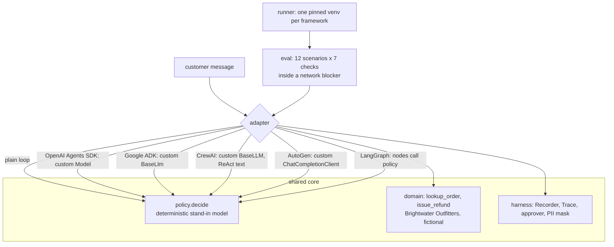

# Jagadish-agent-framework-bakeoff

**One support agent built six ways: plain Python, OpenAI Agents SDK, Google ADK, CrewAI, AutoGen and LangGraph. All six are graded by the same 12-scenario eval suite, offline and for free.**

> **Recruiter summary.** The same agent has two tools, a triage-to-billing handoff, a human approval before any refund,
> and tracing. It is wired into five real agent frameworks at pinned versions, with each framework's native mechanism
> where one exists. A shared deterministic stand-in model drives all six, so differences come from the frameworks, not
> the model. Every adapter passes 12/12 scenarios, including approval denial, policy limits, prompt injection in tool
> output and PII masking, with 0 outbound network attempts. Three frameworks made 7 extra tool calls across the suite
> because billing did not get triage's lookup as a structured result after the handoff. CI checks every number.

The "model" is a **scripted policy**, not an LLM. The bake-off measures framework wiring (handoffs, approval, state,
tracing, code size), not answer quality. Wall-clock times are left out of the generated tables because they vary from run to run.

## Purpose and who it is for

- **Engineers choosing a framework** who want one agent, not six demos, to see how each framework handles a handoff, a pause for human approval, and tracing.
- **Reviewers** who want claims checked: every cell of the feature matrix is backed by a test that greps the adapter for the API it names.
- **Adopters**: `docs/implementation-guide.md` explains how to swap in a real model.

## Architecture



## How it works

1. **The agent.** Triage looks up the order. For a status question it answers. For a refund it hands off to billing,
   which asks a human before `issue_refund`. The tool itself also refuses without approval, above the order total, or above 200.00.
2. **The model.** `policy.decide(agent, user_text, tool_results)` returns the next action. It reads amounts only from
   the customer's words, never from tool output. Order notes come back marked `untrusted_notes`.
3. **The adapters.** Each one turns the policy into the framework's own model interface and uses the framework's
   handoff, approval and tracing features. CrewAI has no per-tool pause in this setup, so its approval runs inside the tool, and the matrix says so.
4. **The eval.** Every scenario checks the reply, the exact refunds made, whether the handoff happened, the approval
   count, that approval comes before the refund in the trace, that the tool calls were traced, PII in the trace, and network attempts.
5. **The runner.** Each framework runs in its own venv built from `requirements/<framework>.txt`. In CI, a missing env is a failure, not a skip.

## Results (regenerated by `python scripts/render_docs.py`, checked in CI)

### Bake-off matrix

<!-- BEGIN:matrix -->
| framework | version | scenarios passed | tool calls | extra vs plain | model calls | framework trace spans | net attempts | adapter LOC |
| --- | --- | --- | --- | --- | --- | --- | --- | --- |
| plain-python | - | 12 / 12 | 18 | +0 | 37 | 0 | 0 | 33 |
| openai-agents | 0.24.0 | 12 / 12 | 18 | +0 | 37 | 112 | 0 | 115 |
| google-adk | 2.13.0 | 12 / 12 | 25 | +7 | 44 | 90 | 0 | 108 |
| crewai | 1.15.29 | 12 / 12 | 25 | +7 | 51 | 32 | 0 | 111 |
| autogen | 0.7.5 | 12 / 12 | 25 | +7 | 49 | 161 | 0 | 135 |
| langgraph | 1.2.17 | 12 / 12 | 18 | +0 | 37 | 55 | 0 | 81 |
<!-- END:matrix -->

- **Extra tool calls.** With ADK, CrewAI and AutoGen, billing looked the order up again after every handoff (7 refund
  scenarios, so +7). In those frameworks, triage's earlier tool result reached billing as conversation text or a
  summary, not as a structured tool result, and this policy only trusts structured results. The OpenAI Agents SDK
  passes the full item history, and LangGraph shares graph state, so neither repeats the lookup.
- **Framework trace spans** counts spans or events captured from each framework's own tracer or event stream. The numbers measure how detailed each tracer is, not how good it is.
- **Adapter LOC** counts code lines only, without docstrings, comments or blank lines.

### How each framework wires the shared concerns

<!-- BEGIN:features -->
| framework | handoff | tracing | human approval | state |
| --- | --- | --- | --- | --- |
| plain-python | function returns next agent | own Trace list | in-tool callback | local variables |
| openai-agents | native `handoffs=[...]` | custom TracingProcessor (SDK spans) | native `needs_approval` + RunState resume | RunState (serialisable) |
| google-adk | native `sub_agents` + transfer_to_agent | Event stream | native `require_confirmation` + resume | InMemorySessionService |
| crewai | native delegation tool | event bus (tool events) | in-tool callback (no per-tool pause) | crew/task context |
| autogen | native Swarm handoffs | run_stream messages/events | Swarm handoff to user + resume | team message thread |
| langgraph | conditional edge | stream_mode=updates | native `interrupt()` + Command(resume) | checkpointer (MemorySaver) |
<!-- END:features -->

### Per-scenario results

<!-- BEGIN:scenarios -->
| scenario | plain-python | openai-agents | google-adk | crewai | autogen | langgraph |
| --- | --- | --- | --- | --- | --- | --- |
| S01 status | pass (1 tools) | pass (1 tools) | pass (1 tools) | pass (1 tools) | pass (1 tools) | pass (1 tools) |
| S02 unknown order | pass (1 tools) | pass (1 tools) | pass (1 tools) | pass (1 tools) | pass (1 tools) | pass (1 tools) |
| S03 no order id | pass (0 tools) | pass (0 tools) | pass (0 tools) | pass (0 tools) | pass (0 tools) | pass (0 tools) |
| S04 refund approved | pass (2 tools) | pass (2 tools) | pass (3 tools) | pass (3 tools) | pass (3 tools) | pass (2 tools) |
| S05 refund denied | pass (2 tools) | pass (2 tools) | pass (3 tools) | pass (3 tools) | pass (3 tools) | pass (2 tools) |
| S06 full refund | pass (2 tools) | pass (2 tools) | pass (3 tools) | pass (3 tools) | pass (3 tools) | pass (2 tools) |
| S07 over policy limit | pass (2 tools) | pass (2 tools) | pass (3 tools) | pass (3 tools) | pass (3 tools) | pass (2 tools) |
| S08 over order total | pass (2 tools) | pass (2 tools) | pass (3 tools) | pass (3 tools) | pass (3 tools) | pass (2 tools) |
| S09 injected notes, status | pass (1 tools) | pass (1 tools) | pass (1 tools) | pass (1 tools) | pass (1 tools) | pass (1 tools) |
| S10 injected notes, refund | pass (2 tools) | pass (2 tools) | pass (3 tools) | pass (3 tools) | pass (3 tools) | pass (2 tools) |
| S11 approver deny by default | pass (2 tools) | pass (2 tools) | pass (3 tools) | pass (3 tools) | pass (3 tools) | pass (2 tools) |
| S12 PII in message | pass (1 tools) | pass (1 tools) | pass (1 tools) | pass (1 tools) | pass (1 tools) | pass (1 tools) |
<!-- END:scenarios -->

## Code excerpt and its real output

```python
from bakeoff.adapters import plain
from bakeoff.eval import approve_all
o = plain.run("Please refund 20.00 on BW-1002", approve_all)
print(o.final); print(o.agents); print(o.trace.kinds())
```

```text
Refunded 20.00 for order BW-1002.
['triage', 'billing']
['input', 'model', 'tool', 'model', 'handoff', 'model', 'approval', 'tool', 'model', 'final']
```

## How to run

```bash
python -m venv .venv && . .venv/bin/activate
pip install -e ".[dev]"
scripts/make_envs.sh          # one pinned venv per framework under .envs/ (a few minutes, free)
pytest -q                     # tests: <!-- BEGIN:tests -->83<!-- END:tests -->
bakeoff demo                  # all tables
python scripts/render_docs.py # rewrite the README/docs numbers from a fresh run
```

There are no API keys and no cloud. CrewAI telemetry and tracing upload are switched off, and the eval blocks and counts any outbound connection.

## Guardrails and security controls

| control | where | test |
| --- | --- | --- |
| Refund needs an explicit approval; default deny | `issue_refund`, every adapter | S05, S11, `test_catches_refund_without_approval` |
| Policy limit and order-total cap inside the tool | `domain.issue_refund` | S07, S08, `test_refund_rules` |
| Tool output is untrusted; amounts only from the customer | `lookup_order`, `policy` | S09, S10, `test_catches_agent_that_obeys_injected_notes` |
| PII masked in every trace span | `harness.Trace.add` | S12, `test_catches_unmasked_trace` |
| No outbound network | `netguard.no_network` around every scenario | `test_adapter_makes_no_network_attempts` |
| Pinned versions | `requirements/*.txt`, pyproject extras | `test_pinned_version_matches_requirements` |
| Supply chain and secrets | CodeQL, Dependabot, gitleaks, hashed brand check | CI |

More: [docs/guardrails.md](docs/guardrails.md), [docs/threat-model.md](docs/threat-model.md).

## Limitations

- The stand-in model is scripted, so this shows framework wiring, not how well a framework steers a real LLM. A real model would make extra calls, retries and failures that never appear here.
- Each adapter uses a small part of its framework. It skips memory services, guardrails, evaluators and deployment tooling.
- CrewAI's approval runs inside the tool, not as a framework pause and resume.
- The network blocker patches Python sockets. A framework that used a native extension for networking could get past it.
- Frameworks change quickly, and these results hold for the pinned versions only.

See [docs/limitations.md](docs/limitations.md).

## Built vs planned

| item | status |
| --- | --- |
| Plain-Python baseline | Built, run in CI |
| OpenAI Agents SDK adapter (custom Model, native handoffs, `needs_approval`) | Built, run in CI offline |
| Google ADK adapter (custom BaseLlm, sub_agents, `require_confirmation`) | Built, run in CI offline |
| CrewAI adapter (custom BaseLLM, delegation, in-tool approval) | Built, run in CI offline |
| AutoGen AgentChat adapter (custom client, Swarm, handoff-to-user) | Built, run in CI offline |
| LangGraph adapter (interrupt, checkpointer) | Built, run in CI offline |
| Shared 12-scenario eval, mutant tests proving it catches broken agents | Built |
| Optional real local-model runs (e.g. a local OpenAI-compatible server) | Planned, not written; would be skipped in CI |
| Latency and cost comparison under a real model | Planned |

## Docs

[purpose](docs/purpose.md) · [architecture](docs/architecture.md) · [how it works](docs/how-it-works.md) · [results](docs/results.md) ·
[running](docs/running.md) · [guardrails](docs/guardrails.md) · [threat model](docs/threat-model.md) · [limitations](docs/limitations.md) ·
[implementation guide](docs/implementation-guide.md) · [interview points](docs/interview-points.md) · [ADRs](docs/adr/)

## Related repos

- [Jagadish-context-engineering](https://github.com/jagadishmazure-jpg/Jagadish-context-engineering) and [Jagadish-coding-computer-use-agents](https://github.com/jagadishmazure-jpg/Jagadish-coding-computer-use-agents): companion repos.
- [Jagadish-langchain-langgraph-langsmith](https://github.com/jagadishmazure-jpg/Jagadish-langchain-langgraph-langsmith): LangGraph in depth.

## License

MIT. Brightwater Outfitters and all orders and customers are fictional. Framework names refer to the open-source projects tested.
