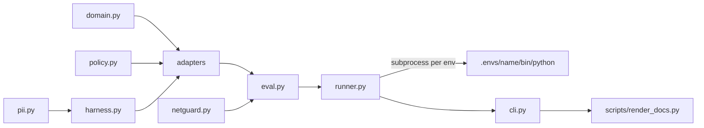

# Architecture

| module | responsibility |
| --- | --- |
| `domain.py` | fictional orders, `lookup_order`, `issue_refund` with approval, limit and total checks; request parsing from customer text |
| `policy.py` | the shared stand-in model: next action from (agent, user text, structured tool results) |
| `harness.py` | `Recorder` (approval, handoff, tool bookkeeping), `Trace` with PII masking, `Outcome` |
| `adapters/*.py` | one per framework, each exposing `NAME`, `available()`, `version()`, `run()` |
| `netguard.py` | blocks and counts non-loopback connections and DNS lookups |
| `eval.py` | 12 scenarios and their checks; a crash counts as a failed scenario |
| `runner.py` | runs each adapter in its own pinned venv; counts code lines |
| `cli.py` | the generated tables, feature claims and the API markers that back them |

Why separate venvs: see [ADR 0002](adr/0002-one-env-per-framework.md).
